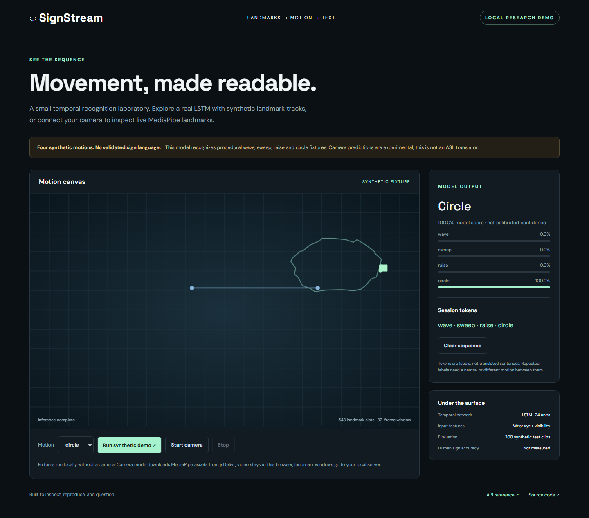
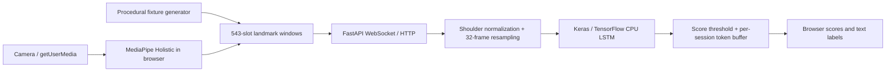

# SignStream

**A temporal landmark recognition laboratory with a runnable CPU demo.**

SignStream explores the engineering pipeline behind sign recognition: browser
capture, skeletal landmarks, normalized motion windows, a small LSTM, and
streamed text labels. The included trained model recognizes **four synthetic
motions: wave, sweep, raise, and circle**. No natural sign language is validated.
It does **not** translate unrestricted signing or generate sentences.



## Run it

Python 3.11 or 3.12; CPU only; no account, API key, GPU, or paid service required.
Run from the repository root; static assets and the checked-in model are read
from the checkout. The editable install is intentional (this is not a standalone wheel).

```bash
python -m venv .venv
# Windows: .venv\Scripts\activate
# macOS/Linux: source .venv/bin/activate
python -m pip install -e '.[dev]'
python -m uvicorn signstream.app:app --host 127.0.0.1 --port 8000 --ws-max-size 2500000
```

Open **http://127.0.0.1:8000**, choose a motion, and select **Run synthetic demo**.
An independently randomized fixture animates before being sent through the actual
saved LSTM. Try another motion to build a token sequence; Clear resets the session.
The app has no prerecorded classification responses. Demo playback requires no
network after Python dependencies are installed (optional fonts fall back locally).

Camera mode requires camera permission and localhost or HTTPS. It loads pinned
MediaPipe Holistic browser assets from jsDelivr on demand. Stop releases camera
tracks. Raw camera video stays in the browser; landmark arrays are sent to the
local Python server. No frames or landmarks are written to disk.

## Architecture and actual stack



- **Frontend:** plain JavaScript, responsive canvas, camera permission and cleanup,
  one outstanding inference at a time, bounded windows and actionable errors.
- **Capture:** browser MediaStream `getUserMedia` from the WebRTC media-capture
  ecosystem. This implementation does **not** use RTCPeerConnection, remote video
  transport, an SFU, or WebRTC signaling; it sends landmarks over WebSocket.
- **Landmarks:** MediaPipe Holistic's 33 pose + 468 face + 21 landmarks per hand.
  Full slots are transported; only two wrists, shoulder normalization, and hand
  presence are classifier inputs. Facial expression and finger shape are not used.
- **Temporal model:** 24-unit Keras LSTM → 16-unit dense → four-way softmax.
  Translation, scale variation, noise, and time warping are generated per clip.
- **Backend:** FastAPI, NumPy, TensorFlow CPU; serialized inference avoids competing
  model calls. Session tokens are isolated by socket and capped at 24.

## Reproduce and verify

```bash
python -m signstream.train
python -m pytest -q
python -m ruff check .
node --check static/app.js
```

Optional browser regression (start the server on port 8010 first):

```bash
python -m pip install -e '.[browser]'
python -m playwright install chromium
python tests/browser_smoke.py
```

This checks all four fixture outputs, session clearing, JavaScript errors, and
mobile overflow, and refreshes the screenshot. It does not request camera access.

The included `models/motion.keras` is genuinely trained. Retraining replaces it
and `models/evaluation.json`. The model card explains the disjoint random seeds,
400/100/200 training/validation/test clips, feature-mean centroid baseline, and
what this evaluation does and does not establish. CI loads the checked-in model
and tests unseen synthetic draws, API rejection, WebSocket behavior, normalization,
resampling, and token state on Ubuntu/Python 3.11.

See [verification evidence](docs/VERIFICATION.md) and the
[machine-readable evaluation](models/evaluation.json) for measured results.

The completed local run scored **200/200 on held-out synthetic clips**, compared
with **41% for the time-averaged centroid baseline**. The LSTM has **3,636
parameters**. Median local eager forward time was **756.37 ms/window** (25 calls,
excluding capture, preprocessing and transport). These are procedural-dataset
results, not natural sign-language accuracy or a general real-time claim.

## Tradeoffs and limits

This is a complete **synthetic motion demo and camera adapter**, not a validated
sign-language translator. No ASL/BSL/ISL training data, signer-independent test,
real-world accuracy, or accessibility usability study is included. A real model
needs consented/licensed signer-diverse data, finger/face features, temporal
segmentation, a neutral class, language-specific annotation, and Deaf-community
evaluation. High softmax scores can be confidently wrong on real camera input.

Windows are 32 non-overlapping captured frames with index-based resampling, not
timestamp-aware alignment. Occlusion, variable frame rate, left-handed signing,
and motions outside the four synthetic classes can fail. Token concatenation
has no grammar or seq2seq decoder. The 0.8 score threshold is not calibrated OOD
detection. Repeated labels require another label or a rejected/neutral interval.

Designed for local use. No authentication, distributed load controls, persistent
storage, public deployment, or multi-user scalability claim. Bind to loopback;
production hosting would require authentication, HTTP body limits, rate limits,
TLS, and operational review. MediaPipe's pinned legacy browser package is a
reproducibility choice; upgrading to Tasks API is future work.

## Portfolio evidence

- Built a browser-to-Python landmark pipeline with MediaPipe capture, 32-frame
  normalization, Keras LSTM inference, and session-isolated WebSocket text output.
- Implemented reproducible synthetic train/validation/test splits and a
  time-averaged centroid baseline; documented the gap between procedural-motion
  results and unmeasured natural sign-language recognition.

## License and provenance

MIT for original code, procedural fixtures, and trained weights. No human video
or private user data is included. Dependency licenses and model limitations are
in the [data/model card](docs/DATA_AND_MODEL.md).
